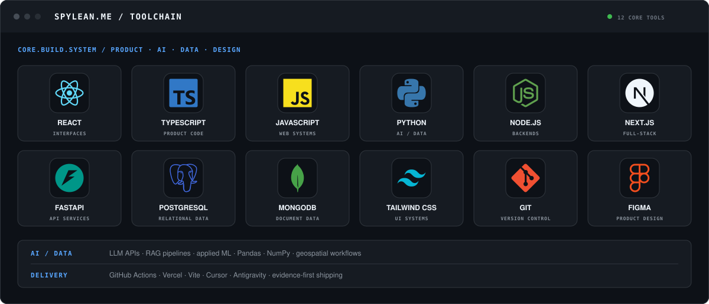

<picture>
  <source media="(prefers-color-scheme: dark)" srcset="./spylean-identity-v8-dark.svg">
  <source media="(prefers-color-scheme: light)" srcset="./spylean-identity-v8-light.svg">
  
</picture>

  <a href="https://spylean-portfolio.vercel.app/">Portfolio</a> ·
  <a href="https://github.com/SPYLEAN/HALT-CyberForge-Final">HALT</a> ·
  <a href="https://forge-ai-two-orpin.vercel.app">FORGE AI</a> ·
  <a href="https://cforge-studio.vercel.app/">CFORGE</a> ·
  <a href="https://circuitclub.in/">Circuit Club</a> ·
  <a href="https://www.linkedin.com/in/tanvir-aditya-bayi-7a6177304/">LinkedIn</a> ·
  <a href="mailto:bayitanviraditya@gmail.com">Email</a>

## About

I’m **Tanvir Aditya Bayi** — a B.Tech Computer Science student, product engineer and creative technologist from Bengaluru. I build evidence-backed cybersecurity systems, adaptive AI products, optimisation engines, games and real-world experiences.

My current flagship is **HALT**, a CyberForge 2026 finalist project for proof-carrying cyber investigation. I also build through **CFORGE**, co-founded **Circuit Club**, and keep translating ambitious ideas into systems people can inspect, use and trust.

## Engineering toolchain

<picture>
  <source media="(prefers-color-scheme: dark)" srcset="./spylean-toolchain-v2-dark.svg">
  <source media="(prefers-color-scheme: light)" srcset="./spylean-toolchain-v2-light.svg">
  
</picture>

## Live engineering proof

<picture>
  <source media="(prefers-color-scheme: dark)" srcset="./spylean-live-v3-dark.svg">
  <source media="(prefers-color-scheme: light)" srcset="./spylean-live-v3-light.svg">
  
</picture>

Updated automatically by GitHub Actions. Activity is shown as engineering proof, not as a vanity score.

## Current operating map

<picture>
  <source media="(prefers-color-scheme: dark)" srcset="./spylean-operations-v8-dark.svg">
  <source media="(prefers-color-scheme: light)" srcset="./spylean-operations-v8-light.svg">
  
</picture>

## Project index

  
  
  
  

  
  
  
  

  
  
  
  

## Flagship engineering

### [HALT — Proof-Carrying Kill Chain Intelligence](https://github.com/SPYLEAN/HALT-CyberForge-Final)

An evidence-backed cyber investigation platform for streaming log ingestion, provenance-aware correlation and reproducible case building. HALT separates observed facts from inference, attaches proof receipts to claims, and withholds conclusions when evidence is unreliable.

<code>Next.js</code> <code>TypeScript</code> <code>FastAPI</code> <code>DuckDB</code> <code>Parquet</code> <code>Three.js</code> <code>Playwright</code>

### [FORGE AI — Adaptive Coding Partner](https://forge-ai-two-orpin.vercel.app) · [Source](https://github.com/SPYLEAN/forge-ai)

A guarded coding partner built around **Imprint → Assign → Orchestrate → Verify → Learn**. Architect, Builder, Critic and Witness perspectives turn a request into inspected work while learning from feedback.

<code>Next.js</code> <code>TypeScript</code> <code>Supabase</code> <code>Cloudflare Workers AI</code> <code>RLS</code>

### [RouteWeigh](https://github.com/SPYLEAN/routeweigh)

A multi-objective itinerary optimiser that balances cost, time and carbon constraints instead of returning a single opaque route.

<code>React</code> <code>FastAPI</code> <code>OR-Tools</code> <code>SQLite/PostgreSQL</code>

### [Rascal Realms: Crownfall](https://rankrascal.lol/) · [Source](https://github.com/SPYLEAN/Rank-Rascal)

A Roblox co-op action-mystery RPG in development, built around investigation, world systems and shared progression.

<code>Roblox Studio</code> <code>Luau</code> <code>Game Systems</code> <code>World Design</code>

## Applied intelligence systems

- **[VARUNA](https://github.com/SPYLEAN/Varuna-maritime)** — maritime anomaly intelligence with explainable geospatial risk.
- **[KYNTRA](https://github.com/SPYLEAN/KYNTRA)** — predictive racecraft, telemetry and energy decision intelligence.
- **[KANNU](https://github.com/SPYLEAN/datathon-2026)** — explainable crime intelligence and case operations.
- **[VenuePulse AI](https://github.com/SPYLEAN/Crowd-flow-optimizer)** — crowd-flow prediction and operator-guided incident response.
- **[Sentinel Memory](https://github.com/SPYLEAN/Sentinel-memory)** — operational memory and recommendations for complex venues.

## Products in the world

- **[Circuit Club](https://circuitclub.in/)** — a Bengaluru culture-and-experience platform co-founded with two collaborators.
- **[DineScope](https://dinescope.vercel.app/)** — restaurant discovery with aspect-level review sentiment.
- **[LETMEIN](https://letme-in.vercel.app/)** — a deployed product and booking experience.
- **[Vertex × Cozyan](https://vertex-cozyan-site.vercel.app/)** — a shipped gaming-lounge and café platform.

## Open channel

I’m open to internships and collaborative work across **software engineering, cybersecurity, full-stack products, AI/ML and product engineering**.

  <a href="mailto:bayitanviraditya@gmail.com"><strong>Start a conversation</strong></a>
  ·
  <a href="https://www.linkedin.com/in/tanvir-aditya-bayi-7a6177304/">LinkedIn</a>
  ·
  <a href="https://spylean-portfolio.vercel.app/">Portfolio</a>

